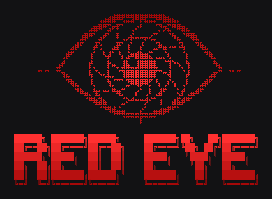

# 👁️ Red Eye - Advanced OSINT & Reconnaissance Framework

<p align="center">
  
  
  
</p>

<p align="center">
  
</p>

**Red Eye** is a blazing fast, highly asynchronous reconnaissance and OSINT framework designed for red teamers, bug bounty hunters, and cybersecurity researchers. Built with raw speed and stealth in mind, it unleashes 22 simultaneous scanners against a target domain to extract critical infrastructure data, hidden endpoints, and leaked secrets.

## 🚀 Features
* **Asynchronous Engine:** Powered by `asyncio` and `aiohttp` with pooled connections. Scans that usually take minutes are executed in seconds.
* **Ghost Mode (`-q` & `-d`):** Tactical delays, randomized jitter, and dynamic User-Agent rotation to bypass strict WAFs.
* **22 Modules:** Subdomains (crt.sh), WAF Detection, GitHub Dorking, Tech Stack, Ports, SSL/TLS, Directories, DNS/SPF/DMARC/DKIM/AXFR, Emails, Wayback Archives, Subdomain Takeovers, JS Secrets, Social Media, Backups, Robots & Sitemaps, Cloud & S3, Breaches (HIBP), Shodan, Security Headers, WHOIS/RDAP, Origin IP / CDN Bypass, and JWT analysis.
* **False-Positive Control:** Directory and backup brute-forcing calibrate against random paths first, so catch-all "200 OK" sites, login redirects and blanket WAF 403s are filtered out. Checks that could not run are reported as *Unknown*, never as *Vulnerable*.
* **Custom Wordlists (`-w`):** Feed your own wordlists seamlessly into the directory brute-forcer.
* **Proxy Routing (`-x`):** Funnels all HTTP traffic (target and third-party APIs, including DNS-over-HTTPS) through an HTTP/S proxy such as Burp Suite. Raw-socket modules (`port`, `ssl`, `origin`) cannot use an HTTP proxy, so they are skipped in proxy mode unless you request them with `-m`.

## 🛠️ Installation

```bash
# Clone the repository
git clone https://github.com/MrEx-Right/Red-Eye.git
cd Red-Eye

# Install dependencies
pip install -r requirements.txt
```

## 🎯 Usage

**Basic Scan (All Modules, Default Wordlist):**
```bash
python3 redeye.py -t example.com
```

**Stealth Minigun (Specific Modules + Custom Wordlist + Tactical Delay):**
```bash
python3 redeye.py -t example.com -m waf,dir,subdomain -w dir -q --delay 1.5
```

**Full Scan Through Burp + GitHub Dorking + Report File:**
```bash
python3 redeye.py -t https://example.com -x http://127.0.0.1:8080 -g ghp_yourtoken -o report.txt
```

While the scan runs, a live dashboard shows every module's status, run time and result. When it finishes you get the detailed panels, a summary table and a **Findings** panel that ranks critical issues and warnings across all modules.

Targets may be given as a bare host, a URL or `host:port` — scheme, credentials, path and query are stripped (`https://www.example.com/login?x=1` → `www.example.com`). Zone-level checks (DNS mail security, subdomains, takeovers, WHOIS, breaches) automatically run against the registered domain (`example.com`).

### Arguments
| Flag | Name | Description |
|------|------|-------------|
| `-t` | `--target` | Target domain, URL or `host:port` (e.g., `target.com`, `https://target.com`, `target.com:8443`). |
| `-m` | `--modules` | Comma-separated list of modules: `subdomain, waf, github, tech, port, ssl, dir, dns, email, archive, takeover, js, sm, backup, robots, cloud, breach, shodan, headers, whois, origin, jwt`. |
| `-w` | `--wordlist` | Name of the wordlist in the `/wordlist` directory (without `.txt`), e.g. `common` or `dir`. |
| `-q` | `--quiet` | Stealth mode: Adds random jitter and lowers concurrency. |
| `-x` | `--proxy` | Route HTTP traffic through an HTTP/S proxy (e.g., `http://127.0.0.1:8080`). SOCKS is not supported; for Tor use an HTTP bridge such as Privoxy. |
| `-d` | `--delay` | Static delay before each request in seconds (e.g., `2.5`). |
| `-g` | `--github-token`| GitHub Personal Access Token. **Required** by the `github` module — GitHub's code search API rejects anonymous requests. |
| | `--shodan-key` | Shodan API key for full host data (falls back to the `SHODAN_API_KEY` environment variable, then to the free InternetDB). |
| `-o` | `--output` | Save the full results (findings summary, untruncated lists, scanner log) to a text file. |
| `-v` | `--verbose` | Show the scanners' live progress logs above the dashboard. |

## 🧪 Testing

The test suite runs fully offline against throwaway local HTTP servers:

```bash
python -m unittest -v
```

## ⚠️ Disclaimer
Red Eye is created for educational purposes, authorized penetration testing, and legitimate cybersecurity research. The developer is not responsible for any misuse, damage, or illegal activities caused by this tool. **Always obtain explicit permission before scanning a target.**

---
*Developed by Mrex*
